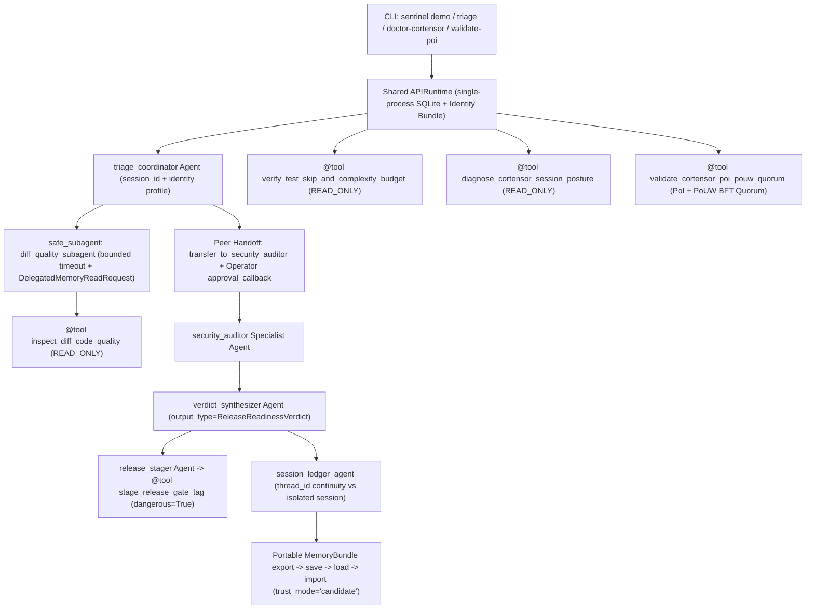

# Cortensor Sentinel (`cortensor-sentinel`)

**Multi-Agent PR, Smart-Contract & `CODE_QUALITY.md` Triage Coordinator + Redundant Miner PoI/PoUW Quorum Validator for Cortensor & OpenMinion**

Built on [`openminion`](https://github.com/openminion/openminion) (`v0.1.20` / `dev @ 2821799`) for **Cortensor Hackathon #5**.

---

## Why Cortensor Sentinel?

Engineering teams shipping decentralized AI agents and settlement contracts on Cortensor face three recurring release hazards before a commit or Router session goes live:

1. **Diff & Smart-Contract Regressions:** Silent `except:` blocks, generic junk-drawer modules (`utils.py`), hardcoded credentials, or Solidity escrow vulnerabilities (`tx.origin` auth, unchecked `.call{value: ...}`, `selfdestruct`).
2. **Cortensor Router vs. Portal Configuration Drift:** Operators configure `CORTENSOR_API_URL`, `CORTENSOR_API_MODE`, or `CORTENSOR_SESSION_ID` via environment variables while `openminion doctor` / `/health` inspects static config defaults.
3. **Redundant Miner Consensus & Useful-Work Verification:** Decentralized inference sessions require deterministic **Proof-of-Inference (PoI)** similarity scoring and **Proof-of-Useful-Work (PoUW)** schema/latency validation to isolate Byzantine or timed-out miners before accepting a release verdict.

**Cortensor Sentinel** solves all three in a single reproducible OpenMinion workflow that runs locally at **$0 API cost** via Ollama (`qwen2.5:7b-instruct` / `qwen3.5:4b`), switches to **Cortensor Portal (`openai_chat`) or Cortensor Router (`cortensor_completion`)** with zero code changes, and includes a deterministic `echo` mode for fast offline CI.

---

## Architecture



---

## All 9 OpenMinion Building Blocks Exercised

Full integration details and edge-case notes are documented in [`BUILDING_BLOCKS_TESTED.md`](BUILDING_BLOCKS_TESTED.md).

| # | OpenMinion Building Block | SDK Surface Used | Module |
|---:|---|---|---|
| 1 | **Shared Application Runtime** | `APIRuntime.from_config_path(..., home_root=..., data_root=...)` | `src/cortensor_sentinel/workflow.py` |
| 2 | **Typed Declarative `Agent` + `output_type`** | `Agent(..., output_type=ReleaseReadinessVerdict)` | `src/cortensor_sentinel/workflow.py`, `models.py` |
| 3 | **Custom `@tool` Decorator & Scopes** | `@tool(min_scope="READ_ONLY" \| "WRITE_SAFE", dangerous=True, idempotent=...)` | `src/cortensor_sentinel/tools.py` |
| 4 | **Bounded `subagent` + Delegated Memory** | `subagent(..., timeout_seconds=..., memory=DelegatedMemoryReadRequest(...))` | `src/cortensor_sentinel/workflow.py`, `sdk_compat.py` |
| 5 | **Peer `Handoff` + Operator Approval Gate** | `Handoff(target=..., name="transfer_to_security_auditor")` + `approval_callback` | `src/cortensor_sentinel/workflow.py` |
| 6 | **Durable `session_id` + `thread_id` Continuity** | Multi-turn `thread_id` recall vs. isolated control `session_id` | `src/cortensor_sentinel/workflow.py` |
| 7 | **Portable `MemoryBundle` Lifecycle** | `export_bundle` -> `save_bundle` -> `load_bundle` -> `import_bundle(trust_mode="candidate")` | `src/cortensor_sentinel/workflow.py` |
| 8 | **Identity & Skill Bundle** | `load_identity_bundle("cortensor-sentinel")` (`AGENT.md`, `SOUL.md`, `SKILL.md`, `NOTES/`) | `agents/cortensor-sentinel/` |
| 9 | **Runtime Self-Inspection & Cortensor Probes** | `runtime_posture()`, `capability_report()`, `tool_inventory_report()`, Cortensor session diagnostics | `src/cortensor_sentinel/workflow.py`, `tools.py` |

---

## Quickstart

### 1. Install

```bash
pip install -e ".[dev]"
```

*(Requires Python 3.11+ and `openminion>=0.1.20` installed in your virtual environment.)*

### 2. Run Locally at $0 Cost with Ollama

```bash
ollama pull qwen2.5:7b-instruct
ollama serve

# Run the full 9-building-block multi-agent workflow against live Ollama:
sentinel demo --live --provider ollama --model qwen2.5:7b-instruct --output artifacts/live_ollama_demo_transcript.json
```

### 3. Switch to Cortensor Portal or Cortensor Router (Zero Code Changes)

**Cortensor Portal (`openai_chat` mode):**
```bash
export CORTENSOR_API_MODE=openai_chat
export CORTENSOR_API_URL=https://api.cortensor.app/v1
export CORTENSOR_API_KEY="<your-cortensor-portal-key>"

sentinel doctor-cortensor --probe-network
sentinel demo --live --provider cortensor --model gpt-oss-20b
```

**Cortensor Router Node (`cortensor_completion` `/api/v2/completions` mode):**
```bash
export CORTENSOR_API_MODE=cortensor_completion
export CORTENSOR_API_URL=http://127.0.0.1:8080/api/v2/completions
export CORTENSOR_SESSION_ID=42

sentinel doctor-cortensor --probe-network
sentinel demo --live --provider cortensor --model gpt-oss-20b
```

### 4. Deterministic CLI Subcommands & Offline CI

```bash
# Audit a git diff + AST pytest skip/complexity ceiling:
sentinel triage

# Validate redundant Cortensor miner Proof-of-Inference (PoI) & Proof-of-Useful-Work (PoUW) quorum:
sentinel validate-poi

# Diagnose Cortensor config vs. CORTENSOR_* environment drift:
sentinel doctor-cortensor

# Run deterministic offline workflow (echo provider) and test suite:
sentinel demo --provider echo
pytest -v
ruff check .
```

---

## Reproducible OpenMinion SDK Findings & Upstream Patches (25% Rubric + Bonus Track)

While building Cortensor Sentinel against `openminion==0.1.20` (`dev @ 2821799`), we uncovered **6 reproducible SDK & Cortensor provider bugs**, built standalone `<60`-line zero-network reproducer scripts (`reproducers/`), implemented clean runtime compatibility wrappers (`src/cortensor_sentinel/sdk_compat.py`), and prepared 6 `CODE_QUALITY.md`-compliant unified patches (`patches/`) with unit tests:

```bash
# Run all 6 standalone bug reproducers in one command:
sentinel reproduce-bugs
```

| ID | Summary | Reproducer | Upstream Patch (`dev @ 2821799`) |
|---|---|---|---|
| **BUG-01** | `Handoff` targeting `Agent(output_type=BaseModel)` crashes `ToolExecutionBatch` JSON serialization | [`repro_01_handoff_basemodel_crash.py`](reproducers/repro_01_handoff_basemodel_crash.py) | [`01_handoff_basemodel_output_serialization.patch`](patches/01_handoff_basemodel_output_serialization.patch) |
| **BUG-02** | `@tool` returning `BaseModel` emits `repr` string in `content` and crashes `ToolExecutionBatch` | [`repro_02_tool_basemodel_return_crash.py`](reproducers/repro_02_tool_basemodel_return_crash.py) | [`02_tool_basemodel_return_serialization.patch`](patches/02_tool_basemodel_return_serialization.patch) |
| **BUG-03** | `_validated_tool_arguments` (`exclude_none=True`) silently overwrites explicit `None` tool args with defaults | [`repro_03_explicit_none_arg_clobbered.py`](reproducers/repro_03_explicit_none_arg_clobbered.py) | [`03_preserve_explicit_none_tool_arguments.patch`](patches/03_preserve_explicit_none_tool_arguments.patch) |
| **BUG-04** | `subagent(parent, ...)` drops `parent.agent_id` and `parent.model` when omitted | [`repro_04_subagent_drops_agent_id_and_model.py`](reproducers/repro_04_subagent_drops_agent_id_and_model.py) | [`04_subagent_inherit_agent_id_and_model.patch`](patches/04_subagent_inherit_agent_id_and_model.patch) |
| **BUG-05** | `Agent._coerce_output` only inspects the first `{...}` span in prose, failing when inline JSON precedes schema JSON | [`repro_05_coerce_output_first_json_trap.py`](reproducers/repro_05_coerce_output_first_json_trap.py) | [`05_agent_coerce_output_multi_json_spans.patch`](patches/05_agent_coerce_output_multi_json_spans.patch) |
| **BUG-06** | `probe_provider_session` ignores `CORTENSOR_*` env overrides + Cortensor chat mode drops `ProviderHTTPClient` pool | [`repro_06_cortensor_doctor_env_and_pool.py`](reproducers/repro_06_cortensor_doctor_env_and_pool.py) | [`06_cortensor_doctor_env_and_http_pool_parity.patch`](patches/06_cortensor_doctor_env_and_http_pool_parity.patch) |

See [`WHAT_WE_LEARNED.md`](WHAT_WE_LEARNED.md) for root-cause tracebacks and maintainer recommendations.

---

## Repository Layout

```text
cortensor-sentinel/
├── agents/cortensor-sentinel/      # OpenMinion Identity & Skill bundle (AGENT.md, SOUL.md, SKILL.md, NOTES/)
├── artifacts/                      # Saved live Ollama end-to-end execution transcript
├── patches/                        # 6 clean git-applyable upstream OpenMinion patches + unit tests
├── reproducers/                    # 6 standalone (<60 lines) zero-network SDK bug reproducers
├── src/cortensor_sentinel/
│   ├── cli.py                      # CLI: triage, doctor-cortensor, validate-poi, demo, reproduce-bugs
│   ├── models.py                   # Pydantic contracts (Diff, SkipBudget, CortensorDiag, PoI/PoUW, Verdict)
│   ├── sdk_compat.py               # Clean runtime compatibility wrappers for v0.1.20 edge cases
│   ├── tools.py                    # @tool functions (READ_ONLY diagnostics + dangerous=True release gate)
│   └── workflow.py                 # 9-building-block multi-agent coordinator workflow
├── tests/                          # Deterministic pytest suite (0 skip/xfail markers)
├── BUILDING_BLOCKS_TESTED.md       # Detailed walkthrough of all 9 OpenMinion building blocks
└── WHAT_WE_LEARNED.md              # Actionable SDK bug reports, reproducers, and ergonomic notes
```
